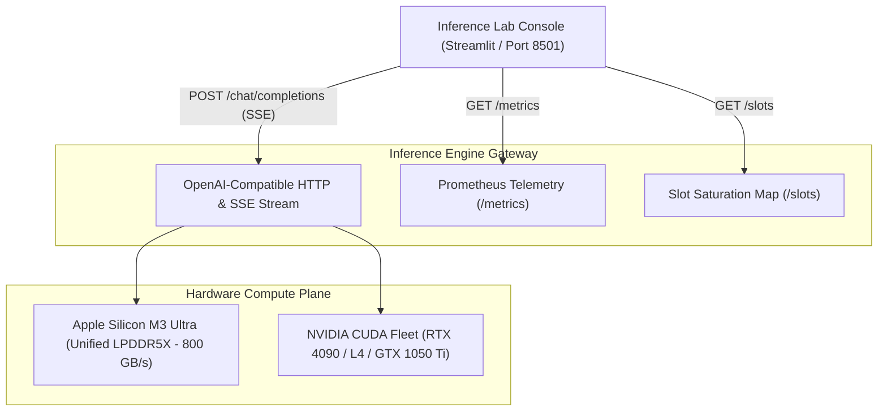

# Inference Lab

Universal systems benchmarking, profiling, and diagnostics console for OpenAI-compatible LLM inference engines (`llama.cpp`, `vLLM`, `Ollama`, `SGLang`, `TGI`, `Triton`).

Built for AI Infrastructure and Platform Engineers to diagnose prefill vs. decode bottlenecks, memory bandwidth utilization (MBU%), inter-token latency (ITL) jitter, KV cache accumulation, and concurrency saturation.

---

## Architecture Overview



---

## Core Systems Capabilities

| Diagnostic Area | Implementation & Metrics |
| :--- | :--- |
| **Prefill vs. Decode Scaling** | Isolates compute-bound prompt prefill throughput (GEMM) from memory-bandwidth-bound token decode (GEMV) across 128 to 4,096 context tokens. |
| **Roofline & MBU% Profiling** | Computes theoretical hardware decode ceiling based on memory bus bandwidth vs. active VRAM footprint, auditing Memory Bandwidth Utilization (MBU%). |
| **Tail Latency & ITL Profiling** | Records per-token generation timestamps ($t_i - t_{i-1}$) to compute ITL mean, p50, p95, p99 tail latency, and renders binned latency distribution histograms. |
| **Closed-Loop Load Testing** | Dispatches concurrent worker pools to identify aggregate throughput saturation plateaus and per-request degradation knees. |
| **Open-Loop Fixed-RPS Injection** | Dispatches requests at strict arrival rates (e.g. 4 req/sec) to expose queue backlog accumulation and compute vs. queue wait latency splits. |
| **Prefix Caching Audit** | Transmits identical context corporas across two sequential passes to quantify KV cache reuse acceleration and TTFT reduction. |
| **KV Cache Context Budgeting** | Visualizes live cumulative token accumulation in conversation context against maximum engine limits. |
| **Grammar & Structured Outputs** | Validates BNF grammar enforcement, strict JSON Schema emission, and OpenAI-compatible function calling schemas. |
| **Determinism Audit** | Audits greedy decoding invariants across 10 identical runs (temp 0, fixed seed) using SHA-256 output hashing. |
| **Continuous Run Vault** | Persists all execution telemetry to disk (`data/inference_runs_vault.json`) with A/B comparative deltas. |

---

## Hardware Roofline Formula

Autoregressive token generation requires streaming all active model parameters through GPU/accelerator compute cores for every single token:

$$\text{Theoretical Decode Ceiling (tok/s)} = \frac{\text{Memory Bandwidth (GB/s)}}{\text{Model Memory Footprint (GB)}}$$

$$\text{Memory Bandwidth Utilization (MBU)} = \frac{\text{Measured Decode Speed (tok/s)}}{\text{Theoretical Decode Ceiling (tok/s)}} \times 100$$

### Verified Silicon Baselines

* **Apple Mac Studio M3 Ultra (256 GB, ~800 GB/s):**
  - Model: Qwen 2.5 Coder 1.5B Instruct Q4_K_M (1.0 GB VRAM footprint)
  - Theoretical Ceiling: 800.0 tok/s
  - Measured Batch-1 Generation: ~135.0 tok/s
  - Measured Memory Bandwidth Utilization: ~16.9% (bandwidth saturation scales with continuous batching)

* **NVIDIA GeForce GTX 1050 Ti (4 GB, 112 GB/s):**
  - Model: Qwen 2.5 Coder 1.5B Instruct Q4_K_M (1.0 GB VRAM footprint)
  - Theoretical Ceiling: 112.0 tok/s
  - Measured Batch-1 Generation: ~45–55 tok/s
  - Measured Memory Bandwidth Utilization: ~44.6%

---

## Quickstart

### Option 1: Docker (Recommended)

Run against a local engine or network server:

```bash
docker run -d \
  --name inference-lab \
  -p 8501:8501 \
  -e INFERENCE_BASE_URL="http://host.docker.internal:8080/v1" \
  -v $(pwd)/data:/app/data \
  srinivassarkar/inference-lab:latest
```

Open `http://localhost:8501` in your browser.

### Option 2: Docker Compose

```yaml
version: "3.8"

services:
  inference-lab:
    image: srinivassarkar/inference-lab:latest
    ports:
      - "8501:8501"
    environment:
      - INFERENCE_BASE_URL=http://host.docker.internal:8080/v1
    volumes:
      - ./data:/app/data
    extra_hosts:
      - "host.docker.internal:host-gateway"
```

Launch with:

```bash
docker compose up -d
```

### Option 3: Local Python Environment

```bash
git clone https://github.com/srinivassarkar/inference-lab.git
cd inference-lab

python3 -m venv .venv
source .venv/bin/activate  # On Windows: .venv\Scripts\activate

pip install -r requirements.txt
streamlit run app.py
```

---

## Environment Variables

| Variable | Default | Purpose |
| :--- | :--- | :--- |
| `INFERENCE_BASE_URL` | `http://100.102.40.99:8080/v1` | Default OpenAI-compatible endpoint URL populated in the sidebar. |
| `DATA_DIR` | `./data` | Directory where persistent execution runs (`inference_runs_vault.json`) are stored. |
| `STREAMLIT_SERVER_PORT` | `8501` | Ingress port for the web console. |

---

## Repository Structure

```text
inference-lab/
├── app.py                      # Core 13-tab Streamlit systems console
├── Dockerfile                  # Multi-stage non-root container definition
├── docker-compose.yml          # Container orchestration manifest
├── requirements.txt            # Python dependencies
├── .dockerignore               # Container build exclusions
├── .gitignore                  # Git exclusions
├── data/                       # Mountable disk directory for persistent run logs
│   └── .gitkeep
└── README.md                   # Systems engineering documentation
```

---

## License

Apache-2.0
